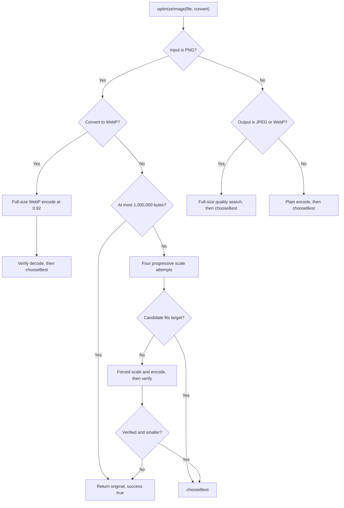

# Image Optimizer

This guide records the implementation in [useImageOptimizer.ts](../../app/composables/useImageOptimizer.ts) and its contract with [ImageUploader.vue](../../app/components/ImageUploader.vue).
Read the current source before changing thresholds, branches or error handling.
The review criteria below describe required behavior separately from observed limitations.

## Ownership And Execution

| Concern                                       | Owner                                                                                               |
| --------------------------------------------- | --------------------------------------------------------------------------------------------------- |
| Decode, scale, encode and candidate selection | [useImageOptimizer.ts](../../app/composables/useImageOptimizer.ts)                                  |
| Batch progress, results, names and downloads  | [ImageUploader.vue](../../app/components/ImageUploader.vue)                                         |
| Result contracts                              | [result.ts](../../app/types/result.ts)                                                              |
| Original/optimized comparison                 | [ImagePreviewModal.vue](../../app/components/ImagePreviewModal.vue)                                 |
| Synthetic Canvas implementation               | [offscreen-mock.ts](../../app/tests/helpers/offscreen-mock.ts)                                      |
| Pipeline tests                                | [composable tests](../../app/tests/composables/), [integration tests](../../app/tests/integration/) |

Processing uses browser-native `createImageBitmap()` and `OffscreenCanvas`.
There is no worker implementation in this repository; an offscreen canvas does not by itself move this code into a Web Worker.
The uploader calls the optimizer sequentially for each selected file.
The optimizer does not upload source images.

## Public Contract

```ts
export async function optimizeImage(
  inputFile: File,
  shouldConvertToWebp: boolean
): Promise<FileResult>
```

`FileResult` contains `file: Blob` and `success: boolean`.
The returned value can be the original `File`, which is also a `Blob`.

| Candidate or path                                   | Returned file                  | Success |
| --------------------------------------------------- | ------------------------------ | ------- |
| Non-null candidate strictly smaller than original   | Candidate                      | `true`  |
| Non-null candidate equal to or larger than original | Original                       | `true`  |
| Null candidate passed to `chooseBest()`             | Original                       | `false` |
| Non-conversion PNG at most 1,000,000 bytes          | Original without decode/encode | `true`  |
| Exhausted PNG optimization with no accepted result  | Original                       | `true`  |
| Error caught by the public entry point              | Original                       | `false` |

Every path preserves the no-larger-output guarantee.
Successful processing does not prove reduction, conversion, output decodability or visual fidelity.
When conversion produces a larger candidate, `chooseBest()` keeps the original format.
Read returned MIME and size before drawing further conclusions.

## Branch Selection

| Input MIME                             | Convert to WebP | Pipeline                                   |
| -------------------------------------- | --------------- | ------------------------------------------ |
| `image/png`                            | `false`         | PNG passthrough or progressive downscale   |
| `image/png`                            | `true`          | Dedicated full-size WebP conversion        |
| Other input with JPEG/WebP output MIME | Either          | Full-size quality search                   |
| Other input with non-lossy output MIME | `false`         | Plain Canvas re-encode and size comparison |

The UI advertises JPG, JPEG, PNG and WebP but the file input accepts `image/*`.
There is no strict MIME allowlist in the composable.
Other formats therefore depend on browser decode/encode support and should not be documented as guaranteed supported formats.



Errors reaching the public catch return the original with `success: false`.
The PNG-to-WebP verification branch has a limitation described below.

## Constants And Size Targets

| Constant                        | Current value | Role                                       |
| ------------------------------- | ------------- | ------------------------------------------ |
| `BINARY_SEARCH_ITERATIONS`      | `6`           | Maximum quality probes per search          |
| `QUALITY_LOWER_BOUND`           | `0.3`         | JPEG/WebP search lower bound               |
| `QUALITY_UPPER_BOUND`           | `0.92`        | Search upper bound and PNG-to-WebP quality |
| `MAX_INITIAL_COMPRESSION_RATIO` | `1`           | PNG initial scale ceiling                  |
| `DOWNSCALE_STEP_FACTOR`         | `0.85`        | Progressive linear scale multiplier        |
| `MIN_ALLOWED_SCALE`             | `0.05`        | Final forced PNG scale floor               |
| `PNG_PASSTHROUGH_THRESHOLD`     | `1_000_000`   | Non-conversion PNG passthrough in bytes    |

These are application settings, not a universal browser quality ceiling or verified visual-quality thresholds.
The encoder's quality argument is not a PNG compression control.
The [HTML bitmap serialization rules](https://html.spec.whatwg.org/multipage/canvas.html#serialising-bitmaps-to-a-file) define quality for variable-quality formats and allow implementation differences.

`computeTargetSize()` uses decimal byte thresholds.

| Input bytes          | Target        | Absolute floor |
| -------------------- | ------------- | -------------- |
| At most 200,000      | Original size | None           |
| At most 1,000,000    | Rounded 90%   | None           |
| At most 5,000,000    | Rounded 60%   | None           |
| At most 10,000,000   | Rounded 25%   | 1,000,000      |
| At most 30,000,000   | Rounded 15%   | 1,500,000      |
| More than 30,000,000 | Rounded 12%   | 2,000,000      |

A target equal to the original size does not skip JPEG/WebP processing.
Small lossy inputs still decode and enter the quality search.
A target is a search budget, not a guarantee that the returned file reaches it.
The UI formats sizes using powers of 1024; that display convention does not change these decimal thresholds.

## JPEG And WebP Search

The non-PNG path selects WebP when conversion is requested, otherwise the input MIME.
For `image/jpeg`, `image/jpg` or `image/webp` output, it draws at the original bitmap dimensions and searches quality between 0.3 and 0.92.

Each of up to six probes encodes at the midpoint.
An oversized probe lowers the upper bound; a probe within target raises the lower bound.
`bestBlob` tracks the smallest probe observed, including candidates above target.
The loop can stop when that blob fits and the quality interval is below 0.01.

This implementation selects the smallest observed candidate rather than explicitly retaining the highest quality that meets the budget.
If no 2D context exists, the candidate stays null and `chooseBest()` returns a failure with the original.
The non-lossy fallback draws when a context is available, encodes once and compares sizes.

## PNG Without Conversion

Files at most 1,000,000 bytes return unchanged before decoding.
Larger PNGs decode once and use the following local settings.

| Setting                           | Value  | Actual effect                                            |
| --------------------------------- | ------ | -------------------------------------------------------- |
| `localMinInitialCompressionRatio` | `0.6`  | Floor on the initial scale before the attempt multiplier |
| `localMaxDownscaleAttempts`       | `3`    | Inclusive loop bound: indices 0, 1, 2 and 3              |
| `localQualityLower`               | `0.5`  | Argument passed to the per-scale search                  |
| `localQualityUpper`               | `0.92` | Argument passed to the per-scale search                  |
| `localFinalForcedQuality`         | `0.35` | Argument passed to the final forced encode               |

For each attempt, the linear scale is:

```text
max(0.6, min(1, sqrt(targetSize / inputSize))) * 0.85^attemptIndex
```

The 0.6 floor applies before the multiplier, so later attempts can fall below 60% dimensions.
`compressImageAtScale()` rounds both dimensions and clamps them to at least one pixel.
It runs six quality probes and retains the last candidate at or below target.
The outer loop returns on the first qualifying scale, using `chooseBest()`.

Because PNG encoding does not use the lossy quality parameter, repeated probes at one scale need not change file size.
Actual PNG reduction comes from the encoded pixels and their dimensions.
Downscaling can reduce text and edge readability; this path does not guarantee visually lossless output.

If all four loop attempts fail to fit, the final scale is:

```text
max(0.05, sqrt(targetSize / inputSize) * 0.85^4)
```

The forced encode uses `image/png` and the configured quality argument of 0.35.
Encoding or verification failure clears the forced candidate.
A verified candidate smaller than the original is accepted even if it misses the target.
Otherwise the original returns with `success: true`.

## PNG-To-WebP Conversion

This path runs for every PNG size when conversion is requested.
It draws at original dimensions and performs one WebP encode at quality 0.92.
It then attempts to decode the output with `createImageBitmap()` before size comparison.

On successful verification, `chooseBest()` selects the smaller file.
An encoding failure leaves a null candidate and normally returns the original with `success: false`.

The current inner verification catch does **not** clear `blob`.
A smaller candidate can therefore be returned with `success: true` after verification rejects it.
This is an observed limitation, not a safety guarantee or a pattern to reproduce.
Correcting it requires a focused invalid-output test alongside the implementation change.

## Bitmap Lifetime And Output Metadata

`closeBitmap()` checks for `.close()` and tolerates a closing error.
The original decoded bitmap is closed on normal completion paths.
Verification bitmaps are not retained or explicitly closed, and some exceptional exits can bypass original-bitmap cleanup.
Review resource lifetime when modifying those paths.

| Returned bytes                     | Metadata implication                                                                    |
| ---------------------------------- | --------------------------------------------------------------------------------------- |
| Original file                      | Original metadata remains intact                                                        |
| Newly encoded Canvas blob          | The code does not copy source EXIF, GPS, IPTC, XMP or embedded thumbnails               |
| Browser-encoded profile/resolution | Encoder-generated metadata may describe the output rather than preserve source metadata |

Do not promise that every download has been stripped of metadata.
The original-file fallback and small-PNG passthrough retain the original bytes.
Canvas serialization can include output color profiles and resolution metadata under the [HTML serialization rules](https://html.spec.whatwg.org/multipage/canvas.html#serialising-bitmaps-to-a-file).
The [ImageBitmap specification](https://html.spec.whatwg.org/multipage/imagebitmap-and-animations.html#dom-createimagebitmap) defines decoding and orientation handling.
Validate representative oriented and color-profiled images in the target browser rather than inferring fidelity from a passing mock.

## Uploader And Download Integration

`ResultItem` stores a stable string ID, display name, original blob, returned blob, both sizes and success.
Starting a batch resets results; a batch ID prevents stale async work from appending after clear or replacement.
Single downloads use the native save picker when available and an anchor/object-URL fallback otherwise.
A native picker `AbortError` returns silently.
Other picker errors fall through to the browser fallback.
ZIP export includes successful results, including unchanged successful originals.

Current filename selection uses the conversion option and success flag to choose a `.webp` extension.
That can disagree with the returned blob when `chooseBest()` keeps the original.
When reviewing naming changes, validate blob MIME and filename together rather than assuming conversion always occurred.

## Review And Verification

| Area                 | Review criteria                                                                                |
| -------------------- | ---------------------------------------------------------------------------------------------- |
| Size guarantee       | Equal/larger candidates and error paths preserve the original                                  |
| Thresholds           | Boundary inputs around 200,000 and 1,000,000 bytes and each target tier                        |
| PNG branches         | Passthrough only without conversion, four loop attempts, forced fallback and actual dimensions |
| Decode/encode safety | Missing contexts, rejected input/output decode, rejected encoding and candidate state          |
| Resource lifetime    | Original and verification bitmap cleanup on success and failure                                |
| Results              | Stable IDs, original blobs, batch invalidation, size and MIME/name consistency                 |
| Downloads            | Native picker success, absence, non-cancel failure and cancellation without fallback           |
| Image behavior       | Real output MIME, decode, orientation, transparency, color and text readability                |

Use [testing](../skills/testing/SKILL.md) for Nuxt mounting, hoisted mocks and browser API restoration.
Run relevant composable, uploader, preview and fixture tests for implementation changes.
The existing fixture integration tests use a simulated encoder; they do not prove the bytes are a valid compressed image.
Use real browser encode/decode and visual comparisons before making fidelity or compatibility claims.
Follow [shared verification](../../AGENTS.md#verification) and report exact coverage and limitations.
